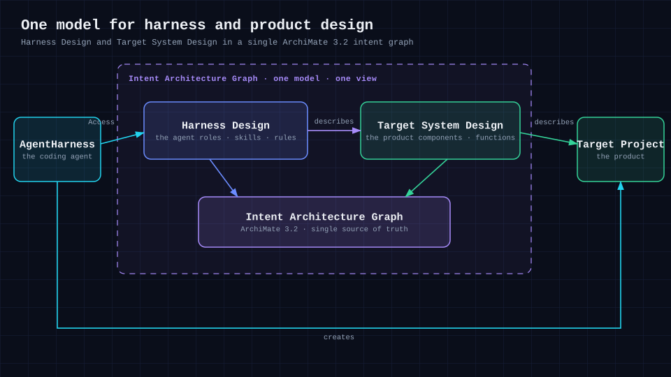
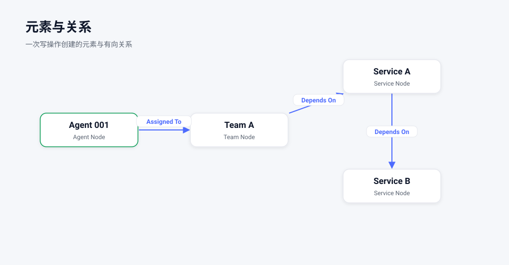

# ArchGraph

**A knowledge-graph framework with an ontology you define — wired into your coding agent through one MCP interface.**

For teams running coding agents on a real codebase, ArchGraph gives the agent durable, tiered long-term memory on an **intent graph** — a versioned architecture graph that records *why* the system is built the way it is, not just how. You and the agent read and write it through a single **MCP** server (**MCP** = **Model Context Protocol**, the open standard that lets an AI tool call external servers as tools). The graph's shape is set by an **ontology** — its vocabulary of element and relationship types — and that ontology is yours to define. The built-in default is **ArchiMate 3.2 + ARGO extensions**, where **ArchiMate** is a standard enterprise-architecture modeling language and **ARGO** is the toolchain and agent-workflow layer behind the `argo-deploy` and `argo-init` commands. A repository can plug in its own ontology — and this one does. **One install, one interface to learn.**

Ready to try it? Jump to **[Build your own graph](#build-your-own-graph)**.

[Install](#install) · [Build your own graph](#build-your-own-graph) · [Why ArchGraph](#why-archgraph) · [Capabilities](#capabilities) · [Docs](#docs) · [Community](#community)



## What is this?

If you run coding agents on a real codebase, every session starts cold and the "why" behind the system lives nowhere. ArchGraph makes **one architecture graph** the single source of truth — the agent's memory and the product's design in one model. It is *one MCP interface* to install and learn: the agent restores context at session start, recalls detail on demand, and reuses what it already knows instead of duplicating it (a duplicate needs an explicit override).

- **Architects / tech leads** — one model of the product, the harness, and the agents.
- **Agent users** — memory restored at session start, recalled on demand, reused instead of duplicated.
- **Platform teams** — one interface, deployed into the editor you already use.

→ Full onboarding: **[docs/getting-started.html](docs/getting-started.html)**

## Why ArchGraph

Every team running coding agents hits the same wall: the code is in the repo, but the *reasoning* behind it lives nowhere. Four common fixes exist, and each works until it doesn't.

The real differentiator is **not** "custom vs. locked". Protégé/OWL, Neo4j, TerminusDB, and Archi/EA all let you extend a model or bring your own vocabulary. It is that ArchGraph makes the ontology a **first-class, validated, runtime-resolved schema bundle** — and puts it behind **one MCP interface** the agent reads *and* writes, with typed dedup and commit traceability built in.

The honest, cost-included comparison lives in one canonical place — **[docs/capabilities.html#compare](docs/capabilities.html#compare)**.

## Bring your own ontology

A knowledge-graph framework that speaks only one language is not a framework. ArchGraph separates the **core** from the **ontology**: a repository drops a *schema bundle* under `.argo/schema/` (element/relationship types, endpoint rules, an actor contract, an optional guide), and validation, MCP guidance, and the `.qea` projection follow it. A bundle can `extends: "default"` — inheriting the built-in **ArchiMate 3.2 + ARGO extensions** — and add its own types; no framework change required.

This repository is the proof: its own bundle uses `extends: "default"` and layers a **UML 2 state-machine profile** on top, resolved at runtime from `.argo/schema/` rather than hardcoded in the framework.

→ Worked example — define an ontology, then build the graph step by step: **[docs/case-team-graph.html](docs/case-team-graph.html)** · runnable bundle: [`custom-schema/`](custom-schema/README.md) · full authoring reference (types, relationship structure, axioms/constraints): **[docs/ontology-authoring.md](docs/ontology-authoring.md)**

## Ontology validation (optional)

Your schema bundle already enforces endpoint rules. ArchGraph can go further and run a **real ontology / reasoning engine** at the same validation timings the framework already uses — **on write** (the change's delta subgraph) and **at init** (the whole graph) — to catch what a schema alone cannot:

- **logical contradictions** (OWL inconsistency — e.g. an element that is two disjoint types, or a single-valued slot with two values), and
- **constraint violations** (SHACL, compiled from your endpoint matrix).

It is **opt-in and off by default**; when enabled it is **fail-close** — a configured-but-unavailable engine is a **blocking error**, not a silent pass (an advisory validator can opt out per entry with `onError: "warn"`).

**Enable it.**

```bash
argo-deploy -EnableOntologyValidation
```

That writes two keys into `~/.argo/.env` (the same file the deployer configures) — you don't hand-edit them:

```
ARGO_ONTOLOGY_PYTHON=python
ARGO_VALIDATION_EXTENSIONS=[{"name":"ontology","timings":["write","init"],"command":["node","<argo>/scripts/ontology-projection/cli.js","--workspace","{workspaceRoot}","--graph","{graphPath}","--mode","{mode}"]}]
```

Then **restart your editor / host** so the MCP server reloads `~/.argo/.env`. Turn it off by clearing the `ARGO_VALIDATION_EXTENSIONS` line (or deploying without the flag) and restarting.

**Dependencies.** The engine is **pySHACL** + **owlready2/HermiT**. The deployer installs the Python packages (`pyshacl`, `owlready2`) for you; **Python 3 and a JRE** are prerequisites — if either is missing the deploy **stops with an alert** (it never installs a system runtime), so install them and re-run `argo-deploy`. Pass `-SkipOntologyEngine` to skip the engine step entirely.

**Verify.**

```bash
Get-Content "$env:USERPROFILE\.argo\.env" | Select-String ARGO_VALIDATION_EXTENSIONS   # ~/.argo/.env on macOS/Linux
python -c "import pyshacl, owlready2; print('ok')"
```

The extension point is **open-closed**: any external validator that speaks the small contract (argv tokens `{workspaceRoot}` / `{graphPath}` / `{mode}`; reads the post-mutation document and touched ids from the environment; prints `{errors, warnings}`) is added as **one entry** in `ARGO_VALIDATION_EXTENSIONS` — no framework change. Spec: [`argo/scripts/ontology-projection/EXTENSION_PROTOCOL.md`](argo/scripts/ontology-projection/EXTENSION_PROTOCOL.md).

## Install

**Prerequisite: Node.js ≥ 18** (the ARGO toolchain and the MCP server both run on Node).

```bash
npm install -g archgraph-argo
argo-deploy
```

`argo-deploy` registers the `argo` MCP server and installs the skills and rules into **GitHub Copilot, Cursor, OpenCode, DeepSeek Harness, OpenClaw, and Codex** (agents are installed where the host supports them). It then prompts for the few settings in `~/.argo/.env`. **After deploying, restart your editor / host** so it reloads the MCP server. Semantic queries additionally need **Neo4j** and an **embedding** endpoint — see [Build your own graph](#build-your-own-graph).

## Quick start

There is **one** canonical start: **[Build your own graph](#build-your-own-graph)** — install once, then pick Route A (the default ontology) or Route B (your own). That section carries every step and MCP call; this one deliberately keeps no second copy, so there is only one path to follow.

**The one prerequisite that is not out of the box:** semantic (Graph RAG) retrieval needs a **Neo4j** instance and an OpenAI-compatible **embedding** endpoint. Context reads, writes, and Enterprise Architect interop work without them; the **Cypher** (Neo4j's graph query language) structural projection and all semantic retrieval need Neo4j.

## Build your own graph

Pick **one** of two routes. Everything happens through your coding agent and the ARGO MCP server; the only commands you run yourself are the install. Once initialized, the intent graph is the single source of truth.

### Route A — default ontology (fastest)

No schema work: use the built-in **ArchiMate 3.2 + ARGO extensions**.

1. **Install (once).** Requires **Node.js ≥ 18**.

   ```bash
   npm install -g archgraph-argo
   argo-deploy
   ```

   Then **restart your editor / host** so it reloads the MCP server.

2. **Initialize.** Ask your coding agent to run `argo-init` (the workspace-init CLI). It creates and validates the starter `design/KG/SystemArchitecture.json`, which already contains the project's root view named `SystemArchitecture`.

3. **Add elements and relationships.** Ask your coding agent to call `applySystemArchitectureMutation` and attach every new element and relationship to the project's **existing root view** — tell it to resolve that view's real `view_id` first (`queryNeo4jGraph` / `getArchitectureViewContext`). Do **not** pre-create a view: a new view called `SystemArchitecture` would collide with the one `argo-init` made, and any `view_ids` pointing at a different id would then fail.

4. **Verify.** Ask your coding agent to call `validateSystemArchitecture`, then `queryNeo4jGraph` with `{"schema": true}` to confirm the element and relationship types in effect.

### Route B — your own ontology

1. **Install (once).** As in Route A.

2. **Author your schema.** Put your modeling language under `.argo/schema/`. A **standalone** bundle — a full `SystemArchitecture.schema.json`, editing its two `$defs` enum arrays, `archimateElementType` and `archimateRelationshipType` — **must also declare `actorElementType` in `schema-bundle.config.json`**, set to one of your element types (or to `null` if your schema genuinely has no actor concept), or loading fails closed (`bundleValidation.status: "failed"`) and validation/writes are blocked. A bundle that only `extends: "default"` needs just the config. `schema-bundle.rules.json` stays optional (without it, endpoint checks are permissive).

3. **Author the graph yourself.** With a custom schema, `argo-init` does **not** create the graph — the packaged default would not match your vocabulary — and it **fails closed** with `NO_DEFAULT_GRAPH`. Before any MCP write, create `design/KG/SystemArchitecture.json` by hand, using your own element and relationship types and your own root view. Then ask your coding agent to run `argo-init` to validate it.

4. **Add into YOUR root view.** Ask your coding agent to call `applySystemArchitectureMutation`, attaching each element and relationship to the root view **you authored** (not the default one).

5. **Verify.** Ask your coding agent to call `validateSystemArchitecture`, then `queryNeo4jGraph` with `{"schema": true}`.

The fully-illustrated, step-by-step walkthrough is **[docs/case-team-graph.html](docs/case-team-graph.html)** (Chinese), and the runnable example bundle is [`custom-schema/`](custom-schema/README.md). The result looks like this:



## Capabilities

Each line links to a short page — this is the map, not the manual.

- **[Tiered long-term memory](docs/capabilities.html#memory)** — a compact working memory at session start, a long-term memory recalled on demand, and an archive.
- **[Pluggable ontology](docs/capabilities.html#ontology)** — ship your own schema bundle; the default (ArchiMate 3.2 + ARGO extensions) is data, not code.
- **[Semantic + structural retrieval](docs/capabilities.html#retrieval)** — Graph RAG recall plus read-only Cypher for exact structure.
- **[Deduplicated writes](docs/capabilities.html#quality)** — reuse an existing element, relationship, or view instead of copying it; near-duplicates are blocked as candidates.
- **[Acceptance-test-first + traceability](docs/capabilities.html#quality)** — every change is testable, and the commit id is registered back onto the element.
- **[Enterprise Architect interop](docs/capabilities.html#interop)** — the graph projects to `.qea`; human EA edits return as a semantic diff.
- **[Federated graph sharing](docs/capabilities.html#federation)** — sovereign graphs joined by a registry–broker; reads authorized and returned by reference.
- **[One MCP interface, six hosts](docs/capabilities.html#harness)** — install once, run in Copilot, Cursor, OpenCode, DeepSeek Harness, OpenClaw, and Codex.

## How to use

**Initialize once** (`argo-init`), then open your project and let your coding agent work. It will:

1. locate the architecture element behind the task before changing anything,
2. arm itself with that element's Skills and Rules,
3. work test-first (GIVEN-WHEN-THEN) and trace every commit back to the graph,
4. reuse an existing element by default — a near-duplicate needs an explicit override.

The intent architecture graph is the single source of truth.

## Supported Harnesses

| Harness | MCP | Skills | Rules | Agents |
|---------|:---:|:------:|:-----:|:------:|
| GitHub Copilot    | ✓ | ✓ | ✓ | ✓ |
| Cursor            | ✓ | ✓ | ✓ | ✓ |
| OpenCode          | ✓ | ✓ | ✓ | ✓ |
| DeepSeek Harness  | ✓ | ✓ | ✓ | ✓ |
| OpenClaw          | ✓ | ✓ | ✓ | — |
| Codex             | ✓ | ✓ | ✓ | — |

A single `argo-deploy` registers the `argo` MCP server and installs all artifacts into each harness automatically.

## Cross-project read/write

Cross-project access runs over **two separate channels** — they must not be conflated:

1. **Local path** — a per-call `workspaceRoot` reads a peer project's graph on the same machine. Writes are **read-only by design**: a foreign write is refused with `WORKSPACE_WRITE_DENIED`.
2. **Federated** — a per-call `projectId` is routed through the **federation center**, authorized there (denied by default), and returned by reference.

Whether the local channel works depends on the harness, because a harness may bridge the MCP server and pin the workspace per call:

| Harness | Local read (`workspaceRoot`) | Local write | Federated read (`projectId`) |
|---------|:----------------------------:|:-----------:|:----------------------------:|
| OpenCode         | ✓ | blocked (`WORKSPACE_WRITE_DENIED`) | ✓ |
| Codex            | ✓ | blocked (`WORKSPACE_WRITE_DENIED`) | ✓ |
| DeepSeek Harness | ✗ | ✗ | ✓ |
| GitHub Copilot   | ✓ | blocked (`WORKSPACE_WRITE_DENIED`) | ✓ |
| Cursor           | 待测 | 待测 | ✓ |
| OpenClaw         | 不涉及 | 不涉及 | ✓ |

DeepSeek Harness **cannot** do local cross-project access: its bridge pins the session workspace, so the request never reaches the server as written and only the federated channel works.

## Community

ArchGraph runs on open co-building: share and reuse **architecture subgraphs** across projects. Sharing is **federated** — each project keeps its graph sovereign, and members register, discover, authorize, and read opened content **by reference** (denied by default; nothing copied or merged). The center is a **registry–broker** that holds federation metadata, never content.

- **Community site** — https://argo.derekworkspacev5.com/archgraph/
- **graph-wiki** (graph-asset home) — https://github.com/derekhu0002/graph-wiki
- **GitHub** — https://github.com/derekhu0002/archgraph

## Docs

- [Getting started](docs/getting-started.html) · [Capabilities](docs/capabilities.html) · [Worked case: Team Graph](docs/case-team-graph.html)
- [Schema bundles / ontology decoupling](docs/schema-bundle-decoupling.md) · [Self-hosted embeddings](docs/self-hosted-embedding-deployment.md) · [MCP acceptance](docs/mcp-acceptance.md)
- [Insights](docs/insights.html) — GraphRAG, agent memory, and portable skills.

## License

[Apache License 2.0](LICENSE)
