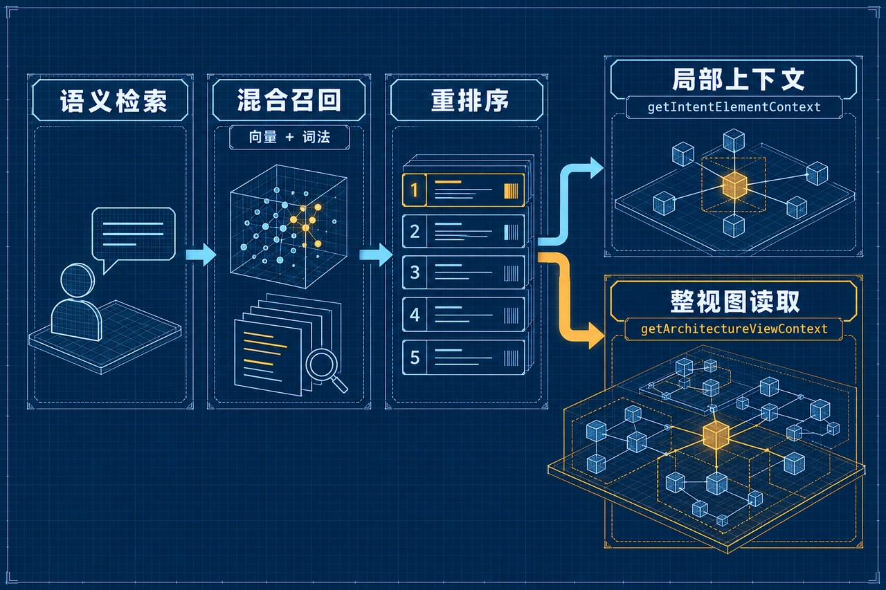

Human–Agent Collaboration · Memory Governance · Retrieval

# AI 时代，人如何与 Agent 一起完成原本做不到的事

先看两种不同的使用方式。常见用法是：人已经知道要做什么、也大致知道怎么做，于是让 AI 帮自己做得更快。更深一层的人机交互范式则是：人提出一个重要、甚至自己不知道如何实现的目标；Agent 负责探索路径与执行；人根据证据判断是否达到目标。两者的差别，不只是效率，而是 Agent 是否把人的能力边界向外推。

从目标定义、人类验收到上下文与记忆治理

## 摘要

当 Agent 只被当作聊天框或自动化工具时，人们往往用它重复自己已经会做的事。更深的变化，是人可以提出一个重要、但自己暂时不知道如何实现的目标，把探索和执行交给 Agent，再以证据和验收标准判断结果。这个过程不是一次性的“提问—回答”，而是一个目标驱动、证据验收、治理反馈的人机协作闭环。要让闭环可靠，问题定义、执行环境、上下文和记忆都必须可治理。尤其是记忆：写入阶段的结构、去重和冲突处理，决定了日后能否只取出最小而可信的上下文。ArchGraph 项目的指标体系提供了一个初步观察框架：以任务完成结果为整体目标，以检索、记忆、工具和验收等指标作为诊断信号，同时诚实保留当前评测的小样本边界。

## 一、Agent 带来的变化，不只是把熟悉的事做快

我们很容易把 Agent 看成一个更方便的聊天工具：给它一段文本，让它总结；给它一段代码，让它补全；让它替我们完成一件原本就知道怎么做的工作。这些用法有价值，但没有触及 Agent 最重要的变化。

更值得关注的情况是：人想解决一个重要问题，却还没有清晰的实现路径；可能缺少相关知识、经验或执行能力，甚至不知道应该从哪里开始。过去，这类目标常常止步于“想做但不会做”。现在，人可以先把问题和目标交给 Agent，让它帮助探索方案、补齐环境并完成执行，再由人判断结果是否真正达到目的。

这并不意味着人不再需要专业判断。恰恰相反，人的工作从亲自掌握每一步操作，更多转向选择值得解决的问题、明确边界、提供关键约束，并对结果作出判断。判断可以由验收标准、证据和必要的专业审查支撑，不必等同于“人必须事先知道全部答案”。

## 二、人机交互从问答走向闭环

一个可用的协作结构包含四个动作：人定义目标；Agent 探索和执行；人检查证据并验收；双方根据偏差修正问题或执行条件。

目标不必一开始就有详细方案。人可以只知道希望达到什么、为什么重要、哪些结果不可接受。Agent 的任务是把目标转成可推进的工作：澄清关键歧义，必要时拆分子问题，识别所需工具和环境，执行并反馈结果与证据。对结果的评价，则回到人类伙伴的目标和约束。

如果结果不合格，下一步不是简单地重复提示，而是诊断失败发生在哪一层。问题可能在目标本身：范围含糊、约束遗漏、成功标准不清；也可能在执行过程：环境缺失、上下文混乱、工具调用失败，或 Agent 推理与验证不足。只有找到原因，反馈才会带来改进。

图 1 展示这个总体闭环：人的目标进入 Agent 的计划与执行，结果和证据返回验收；未通过时，问题会回到需要修正的环节。

*图 1｜从“已知任务提效”到“未知路径协作”：人提出目标，Agent 探索并执行，人依据证据验收。*

## 三、偏差诊断：目标、环境、上下文和执行

目标定义是闭环的入口。对大型问题，人未必需要先给出完整解法，但应尽可能说明目标、范围、约束和验收方式。若这些信息确实未知，Agent 应提出有区分度的问题，或把假设明确标出，再继续能独立推进的部分。

环境决定 Agent 能否实际行动。要查询最新行业事实，需要可用且获准的检索能力；要构建软件，需要代码、依赖、构建和运行环境；要执行外部动作，还需要对应的授权和接口。缺少环境时，Agent 应指出缺口、补环境或请求协助，而不是把无法验证的答案包装成事实。

上下文决定 Agent 在当前任务中能看到什么。上下文过长会占据有限的注意力预算；来源相互矛盾、状态过期或适用范围不明，也会让决策偏离目标。因而上下文治理有两个互补要求：只给任务相关且必要的材料，同时保证材料的含义、来源和适用范围足够清楚。

Agent 自身的执行质量也要检查：是否按计划工作、工具是否成功、关键结论是否有证据、结果是否经过验收。把这些失败原因区分开，才能知道应该修改目标、环境、上下文，还是执行策略。

## 四、上下文治理从记忆写入开始

很多任务所需的上下文来自长期记忆。人类交流时会先回忆相关信息，再决定是否查找外部资料；Agent 也需要可靠的记忆定位和读取能力。要从大量历史中快速找出相关信息，存储阶段就必须有足够结构。若写入时把不同事实、时间、出处和状态混成一团，后续检索再强，也很难稳定还原其含义。

因此，记忆治理不能只发生在读取时。写入至少要处理几类问题：

- 去重与复用：遇到相同对象或知识时先查已有内容，优先复用或更新，减少重复事实和冲突副本。

- 冲突与时效：发现可能相反的陈述时，保留来源、时间、适用范围和状态，判断是否真为同一命题。最新记录未必天然权威，旧记录也可能仍适用于另一范围。

- 本体与结构：用明确的概念、类型和关系承载知识，让后续可以按类别、关系和边界检索。与此同时，模型要允许发现新概念，并以受控方式扩展。

- 无损与可追溯：修订时避免静默删掉仍有价值的内容；需要替换或删除时保留变化依据，必要时让人确认。

“用一个更高层原则解决冲突”有时有效，但不能当作通用逻辑消解器。现实中的冲突往往是来源可信度、时间、适用范围或价值取舍不同。系统应先把冲突显性化，再依据预先说明的权威层级与原则判断；若证据不足或价值选择属于人，应保留不确定性并交由人决定，而不是任意选一句。

图 2 展示从资料进入、经治理门禁形成结构化知识，再从相关局部取回精简证据包的路径。它强调：检索从治理后的知识开始，不是绕过写入质量直接搜索原始材料。

*图 2｜记忆写入治理：去重、冲突与时效、本体结构、无损追溯共同为可信读取打基础。*

## 五、读取时追求“足够小、足够干净、足以完成”

*图 3｜检索输出链路：语义检索定位意图，混合召回补足词面命中，重排序筛选候选，再按任务读取局部子图或完整视图。*

结构化存储的目的不是让分类本身变得复杂，而是让读取更可靠。读取可以先用语义理解问题的大意，结合词汇命中、图结构和适用范围确定候选，再按相关性排序并取回必要上下文。ArchGraph 的读取工具链可按任务组合：先用带 purpose 与 intent 的全局语义检索定位候选；需要补足精确词面命中时，叠加向量与词法/BM25 的混合召回，并通过 RRF 融合；候选较多时再做二阶段重排序；命中后用 getIntentElementContext 沿焦点元素读取相关子图，或者用 getArchitectureViewContext 完整读取一个视图的成员与关系。若任务确实要求穷尽性盘点，再逐视图展开所需范围；完整视图提取有明确边界。整图提取（例如不带 query 的完整架构读取）只适合确需全局盘点的场景，仍应按范围分步展开，避免把整张图无差别铺入上下文。一次全局召回之后，可以沿相关关系继续深入；但应只扩展到回答当前任务所需的范围。

最小上下文不是机械地追求最少字数。上下文少到缺少关键约束、证据或验收条件，Agent 同样会失败。更实际的目标是：只提供完成当前目标所需的材料，并让每项关键结论都能追溯到依据。

纯净上下文也不是把一切分歧都预先抹掉。应区分确定事实、不同来源的说法、已过期状态和未决争议。必要时把冲突与假设显式交给 Agent，要求它遵循明确的来源优先级，或者停止并向人求证。这样才能让“少而相关”与“可信可判断”同时成立。

## 六、用整体结果和局部信号评价系统

如果要把这套协作方法变成工程实践，就需要知道它有没有帮助人真正完成目标。ArchGraph 的指标图将任务完成成功率作为整体结果指标，并把计划、检索、工具、验收等局部指标连接到整体任务结果；另设端到端时延、成本和可复现性，观察结果的代价与稳定性。

记忆和检索指标是诊断层，不是最终目标。项目评测口径分别关注查询层的准确、召回、时延与成本、证据溯源和可读性，以及写入层的冲突识别、实体归一、结构拓扑、保真压缩和增量更新。这样的分层对应一个重要原则：读取的效果最终要回到任务价值；写入的效果，则应通过它对准确性、召回、上下文成本和维护成本的影响来判断。

项目已有评测提供了一些阶段性信号：自建记忆评测题集最近记录为 31/31，通过率 100%；导航 20/20；一组 10 题的对照评测也记录 100%。检索黄金集的部分评测记录了向量召回@1 94.6%、召回@5 99.4%、MRR 0.967；加入二阶段重排的若干轮实验在不同样本和配置下达到更高的首位召回。它们说明某些受控子任务可以被量化和回归，并不等于整体 Agent 工作效果已被证明。

*图 4｜整体结果与局部诊断：以任务成功率回答是否完成，以检索、记忆和过程指标解释成败。*

整体任务完成成功率在图谱中仍标记为 partial：上述都是自建的小样本或专项任务，还不是覆盖真实 coding 任务全流程的整体基准。不同记录中也出现了不同轮次的 token、延迟与压缩率数值；在实验标识、数据集和统计口径统一以前，不应把它们拼成同一条性能结论。也就是说，整体指标与专项子任务结果不是同一口径。图 4 将“整体结果”和“局部诊断”画在不同层级，提醒我们用整体成功率回答“有没有完成”，再用局部指标回答“为什么成功或失败”。

## 七、从观点到可运行的方法

要让闭环不止停留在理念，可以把一次任务看成一个带证据的工作单元：写清目标和验收条件；记录 Agent 使用的关键上下文、环境和工具；为关键结果保留证据；验收失败时把问题归到目标、环境、上下文或执行；修正后重跑相关验收，并把可复用的决策沉淀到长期记忆。

这也为个人和团队带来不同的能力要求。人不必预先掌握所有实现细节，但需要能够提出值得解决的问题，做出边界选择，并对结果作出负责的判断。Agent 不只是服从指令的接口，而是一个需要被提供环境、上下文和可检验目标的执行参与者。系统的设计，则要同时支持写入治理、按需读取、过程证据和结果验收。

## 结语：把能力边界交给协作来扩展

AI 时代一个值得认真对待的变化，是人能够发起自己尚不懂如何实现的目标。Agent 可以探索和执行，但结果是否满足目标，仍要回到人的判断和验收；失败也不必归咎于一句含糊的“模型不够聪明”，而要拆解为目标、环境、上下文和执行问题。

长期记忆是这套协作结构的重要基础。它不仅要能存得下，更要能在写入时保持可辨识、可追溯、可更新，在读取时给出与任务相称的上下文。最终，衡量这些设计的，不是图谱有多复杂或检索分数有多高，而是人和 Agent 是否能更可靠地完成原本难以完成的工作。
ArchGraph｜人机协作、记忆治理与检索工程
